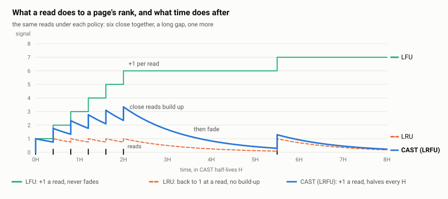
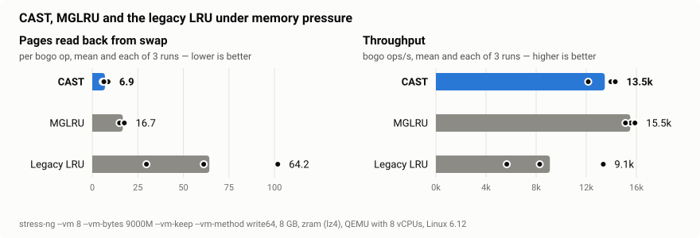

# Cost-Aware Self-Tuning LRFU (lru_cast)

CAST is an out-of-tree page replacement policy for the Linux kernel, taking the place of the active/inactive LRU lists. It ranks pages by an LRFU score — an exponentially decayed count of their reads — and it does not ask you to tune it: how fast the score decays, how much room newcomers get, and how memory is split between anonymous memory and the page cache are all **measured** on a running sample of the system's own pages and set from what is measured.

Two properties are what CAST is built for:

- **Accuracy.** It evicts the pages least likely to be wanted again. Measured in QEMU against MGLRU and the legacy LRU, CAST reads back from swap **about a quarter** as many pages as MGLRU (0.28×) and a tenth of what the legacy LRU does — and, choosing that well, gets **12% more work done than MGLRU** on the same workload ([Results](#results)).
- **Swappiness that sets itself.** CAST measures how long tasks actually wait for an evicted page of each type to come back — a swap-in from zram, a file read from an NVMe or a spinning disk — and splits memory between anon and file where the total waiting is least. `vm.swappiness` is only where that estimate starts; the measurement takes over as it accumulates ([Swappiness](#swappiness-measured-not-guessed)).

Of the two, accuracy is what a page replacement policy is for: a page evicted wrongly costs a task microseconds to milliseconds of waiting, where choosing well costs nanoseconds of CPU — see [Accuracy over throughput](#accuracy-over-throughput).

CAST is a successor to [Marie LRU](https://github.com/firelzrd/lru_marie): it keeps Marie's per-PFN state array, SIMD page-table walker, rmap-fed bloom filter, look-around, two-stage prefetch, `kcompressd` and clean-file floor, and replaces Marie's generational ring with a measured, self-tuning LRFU.

---

## Background

Every page replacement policy answers one question: of the pages in memory, which will be wanted again last? The two in the kernel answer it by recency.

**Legacy LRU** keeps an active and an inactive list per memory type. A page read twice moves to the active list; reclaim takes from the tail of the inactive list. Within a list there is no further order, and a streaming read the size of the inactive list washes the working set out.

**MGLRU** (`lru_gen`) replaced the two lists with a ring of generations, harvested by a page-table walker. It orders pages better, but still by *when* they were last used, in four coarse steps.

**LRFU** (Lee et al., 2001) ranks a page by how often *and* how recently it was read: each read adds 1 to its score, and the score halves every half-life H. With H short it is LRU; with H infinite it is LFU; in between it beats both — if H is right for the workload. That has been LRFU's weakness from the start: H is a knob, and the right value changes with the workload.

<picture>
  <source media="(prefers-color-scheme: dark)" srcset="docs/signal-dark.svg">
  
</picture>

CAST's answer is to stop guessing. A sample of about 15,000 of the system's pages runs, at every moment, through simulated copies of the cache at nine decays, two window sizes and eleven anon/file splits. Whichever does better, by a statistical test, is what the real cache uses.

Legend — ✅ behaves as expected · ⚠️ works with a trade-off · ❌ not provided

| Aspect | Legacy LRU | MGLRU | CAST |
| :--- | :--- | :--- | :--- |
| What a page is ranked by | ⚠️ recency, two buckets | ⚠️ recency, four generations (tiers add a little frequency for files read through `read()`) | ✅ frequency and recency (LRFU), a key in 1/16 half-life steps |
| Rank tuning | — | — | ✅ the decay chosen by measurement, per type |
| anon/file split | ⚠️ `vm.swappiness` as a fixed scan ratio, plus rules (`cache_trim_mode`, `file_is_tiny`) | ❌ `vm.swappiness` reduced to a per-generation hint | ✅ chosen from each type's measured miss-ratio curve and refault cost |
| What a refault costs | ⚠️ counted as I/O events | ⚠️ counted as refaults | ✅ measured: the time a task waited, on each device apart and less its time queued behind others, plus what writing anon out takes |
| Streaming read past a working set | ❌ working set evicted | ❌ working set evicted | ✅ newcomers wait in a window and must outrank the working set to stay |
| Compression stall | ❌ kswapd blocks in `zswap_store` | ❌ same | ✅ per-node `kcompressd` writes the page and finishes its reclaim |
| Clean-file floor | ❌ none | ❌ none | ✅ `clean_min_ratio` (from [le9uo](https://github.com/firelzrd/le9uo)) |
| cgroups | ✅ per-memcg lists | ✅ per-memcg generations | ✅ per-lruvec, as the stock lists; folios moved to a parent on 7.1+ are retagged |
| Run-time switch | — | ✅ | ✅ `enabled`, off and on at run time |

---

## Results

Measured in QEMU (8 vCPUs pinned, 8 GB, zram swap with lz4) on Linux 6.12, CAST 0.2.5.

<picture>
  <source media="(prefers-color-scheme: dark)" srcset="docs/results-dark.svg">
  
</picture>

### Accuracy and throughput: pages read back

`stress-ng --vm 8 --vm-bytes 9000M --vm-keep --vm-method write64` in 8 GB for 90 seconds: a working set larger than memory, so every policy must evict, and every page it evicts wrongly comes back as a swap-in. Three interleaved runs each; pages per bogo operation, and operations per second:

| Policy | Swap-ins (`pswpin`) | Swap-outs | bogo ops/s |
| :--- | :--- | :--- | :--- |
| **CAST** | **4.31 – 4.48** | **4.43 – 4.54** | **21.6k – 23.1k** |
| MGLRU | 14.4 – 16.7 | 14.5 – 16.8 | 19.1k – 20.6k |
| Legacy LRU | 18.0 – 63.5 | 18.1 – 63.7 | 10.8k – 20.1k |

CAST reads back **0.28×** what MGLRU does and writes out as little, run after run within 4% of itself — and does **12% more work** in the same time, the CPU it spends choosing more than repaid by the swap-ins it saves. (`workingset_refault_anon` also counts zero-filled pages, which come back without I/O; `pswpin` counts only the reads.)

A loop over more than memory is where a policy that ranks by recency does worst: every page it evicts is the one about to be read again. CAST keeps the same part of such a loop in memory pass after pass (see [W and M](#w-and-m)), and lets the rest go.

### Accuracy: a working set under a streaming read

A working set of 300 MB that fits in memory, read every 100 ms, while `tail /dev/zero` fills memory past it until it is killed. Two runs each:

| Policy | Faults on the working set | Longest fault |
| :--- | :--- | :--- |
| **CAST** | **7 / 2** | **4.8 / 5.5 ms** |
| MGLRU | 77,486 / 17 | 627 / 6.3 ms |
| Legacy LRU | 15 / 16 | 3.6 / 3.3 ms |

The stream's pages enter CAST's window with one read each; to stay, they must outrank pages read many times, and they cannot.

### Swappiness: choosing the split

In the simulator the policy was designed in (90 workload conditions, 2 million accesses each), the anon/file split chosen from miss-ratio curves cost on average **5.9% less** than the best *fixed* split — the one that, in hindsight, was best for each condition — and at worst 12.3% more. The other ways of splitting tried, comparing pages' scores across the types or following the gradient of the split, were at worst 39% to 19,000% worse.

In the kernel: with cold anonymous memory next to a file working set larger than RAM, starting from the share memory happened to have, CAST moved anon's share from 65% down to its 10% floor in about 30 seconds, giving the memory to the file cache that was being read.

### Accuracy over throughput

A page replacement policy exists for one job: to keep in memory the pages that will be wanted, so that nobody has to wait for them. Every page it gets wrong is paid for twice — once to write it out, and once more, by a task that stops and waits, to read it back. That wait is what a user feels: a window that does not redraw, a keystroke that lands late, a build that crawls. And it is orders of magnitude larger than the work of choosing. In the runs above, CAST measured a swap-in from zram at 10–20 µs; a read from an SSD takes tens to hundreds of microseconds, from a spinning disk milliseconds. Recording a read of a page costs CAST nanoseconds.

A throughput benchmark under memory pressure hides this. `stress-ng` counts operations per second across all its workers: a fault that stalls one of them for 600 ms barely moves the average, and the CPU time a policy saves by choosing less carefully shows up as more operations. With a working set under a streaming read, MGLRU left a task waiting up to 627 ms on some 77,000 faults in one run of two, where CAST had a handful of faults of about 5 ms in both.

So CAST spends CPU to choose well: it records every read in the page's state word and keeps the sample's simulated caches. On the workload above that is more than paid back — CAST does 12% more operations per second than MGLRU and half again as many as the legacy LRU, because it reads back a quarter of the pages MGLRU does. For a page replacement policy, accuracy is the measure; the CPU it costs is the price, and here the price comes back with interest.

---

## How it works

```
   a read: fault, read(), folio_mark_accessed(),          the walker, once a tick:
   young bit found by reclaim or the look-around          young bits of every page table (SIMD)
                      │                                              │
                      ▼                                              ▼
        ┌───────────────────────────────────────────────────────────────────┐
        │ state word per page frame, 32 bits, in an array indexed by PFN    │
        │ last read's tick · the two gaps before it · owner tag · read count│
        └───────────────────────────────────────────────────────────────────┘
                      │ key = E/H + log2(score): changes only on a read
                      ▼
   ┌────────────────────────────────────┐      ┌────────────────────────────────┐
   │ per lruvec and type:               │      │ the controllers (a sample)     │
   │  W  newcomers, FIFO (inactive list)│◄─────│  decay · W's share · the split │
   │  M  the rest, no order (active)    │      │  set from simulated caches and │
   │  reclaim: W's tail vs M's lowest   │      │  miss-ratio curves, by tests   │
   └────────────────┬───────────────────┘      └────────────────────────────────┘
                    │ both types, pressed toward the split
                    ▼
          shrink_folio_list ── anon ──► kcompressd (per node): write, finish reclaim
```

### A state word per page

Every page frame has one 32-bit word in a flat array indexed by its PFN — no lookup, no allocation in the hot path, backed one memory section at a time as memory comes online (1/1024 of memory). It holds the clock tick of the page's last read, the gaps back to the two reads before it (each to within a factor of two), the tag of the lruvec it belongs to, and its read count. Writes are lock-free.

### The clock and the key

Time is not wall time but pressure: the clock counts the pages the node takes in, less those their owners free, and ticks every quarter of what memory holds. While nothing comes in, nothing ages.

A page's score is its reads decayed with half-life H. Because the score of every unread page decays at the same rate, the order of two unread pages never changes — so CAST ranks by a key, `E/H + log2(score)`, which changes **only when the page is read**. Nothing is re-sorted as time passes.

### W and M

Each type of each lruvec is a cache in two parts:

- **W**, the window: newcomers in arrival order. It is the stock inactive list.
- **M**, the main part: everything else, in no order. It is the stock active list.

While W is over its share, its tail meets M's lowest key; the lower goes. A page read once on its way through — a stream — goes; a page read again stays.

Pages of one key — read in the same ticks, as many times — are told apart only by which is taken first, and that is chosen for what such ties are. Of pages read once, the sweep's order is kept: a clock, in which a page read again since it was found is passed over, and a newcomer from W wins a tie, being the one read last. Of pages read more than once, a tie is a loop's: a working set cycled through in turn. A loop larger than memory is served best by keeping the same part of itself, so these are ranked by a hash of the page frame — the same of them go first every time, spread evenly over the processes they belong to, and the rest stay and are hit on every pass. Ranked by the sweep's rotating cursor instead, a loop loses the pages it is about to read again.

M's lowest is found by **sweeping the state words** in PFN order and keeping the 128 lowest keys as candidates: a per-lruvec bitmap of 256 blocks skips the parts of memory where M has no page, the sweep stops once it holds enough keys below the 1/16 quantile of the last pass, and each candidate is checked against its page before it is taken. Where the frames to be read next are known ahead — the candidates, young PTEs — they are pulled toward L3 and then L1 in two stages, as far ahead as the CPU's miss buffers allow.

### The controllers

A sample of about 15,000 pages, chosen by block so that readahead runs stay whole, feeds simulated caches at once:

- **the decay**: nine caches at the current half-life and ±1, 2, 4 and 8 steps from it, from le 1 — a half-life of 128 times memory, close to LFU yet still ageing — to le 14. One that misses less by two standard deviations (a sign test on the accesses where they disagree) becomes the new centre. There is no le 0: with no decay a key is the read count alone, pages read 255 times or more tie, and a set read often once stays however long it is not;
- **W's share**: two caches with W 10% of the type's pages smaller and larger, moved by a sequential test of the gradient, each step taken on evidence gathered since the last;
- **the split**: each type's miss-ratio curve at 1/10 to 10/10 of memory, read from one order of the sample's pages, with readahead simulated at each point. The split that loses least — each type's misses weighed by what its refaults cost — is anon's share, moved only when another is better by two standard deviations.

Reclaim presses both types toward the split rather than taking only from the type over it: a page of each type is pressed by how far its type is over its share, as a swappiness held within 1–199, like one an administrator sets. No type is ever left alone, and a type that will not give — anonymous memory in use — keeps its pages while the other gives in its place.

Each simulated cache is the main cache in small, ties included: pages of one key are taken in the same order as there, so that what the controllers choose is chosen for the cache they set.

Pages that are mapped and sampled are made `PROT_NONE`, as NUMA balancing does, so that every read of them faults and is seen (while NUMA balancing is off).

### Reads of mapped pages

A read of a mapped page leaves only the PTE's young bit. Once a tick the walker reads every process's page tables for young bits — a whole table at once with AVX-512, AVX2 or SSE2 — skips what cannot have been read (an mm no CPU ran, a PMD whose accessed bit is clear, or failing that one reclaim's look-around did not find young), and takes no bit that would add nothing (a page already read this tick). Program text is not walked: reclaim keeps it while it is in use.

### Swappiness: measured, not guessed

Each refault a task waits for is a sample: an anon major fault's swap-in, or a file fault or `read()` that waited for a page that came back with its history.

A wait is timed as the device's work on it, not from asking to having: a page that queued behind others is not charged for their time. Waits queue where they are served: a swap-in the task works off itself — a synchronous read from zram, a zswap hit, a zero-filled page — on its CPU; a read from a disk on that disk's queue, which swap and file on the same disk share. On each queue, the waits in flight together are a burst, and each is the time from the end before it to its own; the first to end is timed from the burst's start. The clock is read at a burst's start, at its last end and every 16 ends between, the ends since the last reading sharing the time alike, so that a storm of fast swap-ins costs no more for being timed.

Evicting a file page costs nothing; evicting anon costs writing it out — compressing it, or submitting it to its device — and that time is measured too, on every path that writes anon out, and added to anon's cost: in the steady state every miss is also an eviction.

Per type, CAST keeps the waits' sum and number, forgetting both by half once there have been as many as the LRUs hold pages:

```
cost = (prior + sum of waits) / (1 + waits)  [+ the cost of writing a page out, for anon]
```

The prior is one sample in the ratio `vm.swappiness` gives, anon : file = (200 − s) : s. With no waits the cost is the prior; with many, it is what was measured. The split then weighs each type's misses by its cost: on zram, where a swap-in takes microseconds, anon is cheap to lose and the cache keeps more file; with swap on a slow disk, the other way round — without anyone setting anything.

What this amounts to is shown, as the swappiness it equals, in `/sys/kernel/mm/lru_cast/estimate`:

```
share 0/1000
swappiness 196
cost anon 5522 ns (1034286 waits) file 348935 ns (15237 waits)
swap-out 2432 ns (661733 pages)
in flight 0
cpu: anon 3667 ns (20692922) file 0 ns (0) swap-out 2696 ns (21034646)
bdi 9: anon 0 ns (0) file 350346 ns (15035) swap-out 0 ns (0)
```

Here anon is swapped to zram, read back on the CPU in under 4 µs, and file is read from a disk at 350 µs: the cache keeps file. Anon's part of memory counts what zram or zswap holds compressed as well as its pages on the lists — a page swapped to zram frees only what compressing it saves.

Three values of `vm.swappiness` are promises, kept outside the measurement:

| `vm.swappiness` | Meaning under CAST |
| :--- | :--- |
| `0` | never swap: file only, and at the floor nothing (then OOM) |
| `1` | file first, down to the floor, and only then anon |
| `200` | anon first, while swap lasts, and only then file |

Any other value is only where the estimate starts.

### The clean-file floor

From [le9uo](https://github.com/firelzrd/le9uo): no reclaim takes clean file while the node's clean file is at or below `clean_min_ratio` percent of its memory and there is anon to take instead. With anon unreclaimable as well, nothing is reclaimable and the stock OOM path fires, instead of the system thrashing on its own code. Reclaim forced by a cgroup's own limit (`memory.max`, `memory.high`) is exempt, so that a cgroup is never OOM-killed while it has file to give.

### kcompressd

From [kcompressd-unofficial](https://github.com/firelzrd/kcompressd-unofficial), by way of Marie: kswapd hands an anonymous page bound for swap to a per-node thread, together with the rest of its reclaim, and goes on; the thread compresses and writes it (one bio per run of contiguous slots on a synchronous device such as zram) and frees it. With the queue full, kswapd writes the page itself. +4.5% throughput on the workload above.

### cgroups and memory hotplug

CAST keeps its state per lruvec, as the stock lists do, so cgroup reclaim is the stock walk over each cgroup's lruvecs. Which type reclaim takes from is decided on what the lruvec's own lists hold, not on the memcg's statistics, which the kernel sums up only every couple of seconds: a cgroup filling up to its `memory.max` would show nothing to take yet, and be OOM-killed with its pages unscanned. A folio of M carries its lruvec's number in its state word; on 7.1 and later, where a cgroup taken offline splices its lists onto its parent's, the moved folios are retagged by a work item. Memory hotplug attaches and detaches the state array a section at a time.

---

## Tunables

Under `/sys/kernel/mm/lru_cast/`. **None needs setting**: the defaults are the design.

| Knob | Default | What it is |
| :--- | :--- | :--- |
| `version` | — | the release |
| `enabled` | `1` | switch CAST off and on at run time; switching it on while MGLRU is on is refused (`EBUSY`) |
| `estimate` | — | anon's share of memory, the swappiness the measured costs amount to, the costs, the cost of writing anon out, the waits in flight, and the same per queue (the CPUs, each device) |
| `tune` | — | the controllers: per type the decay and W's share, and each simulated cache's misses |
| `decay_auto` | `1` | the controllers set the decay and W's share; `0` leaves them as set by hand |
| `decay` | measured | the decay per type, 1–14 (half-life C·2^(8−le) pages taken in). Writing stops `decay_auto` |
| `w_permille` | measured | W's share per type, ‰ of its pages. Writing stops `decay_auto` |
| `clean_min_ratio` | `10` | the clean-file floor, % of a node's memory; `0` = none |
| `floor_held` | — | reclaim passes the floor held |
| `balance` | — | reclaim calls that took anon, file, nothing, both by size (the last pass before OOM), or both pressed toward the split |
| `clock` | — | per node: pages taken in, pages evicted, the tick |
| `sweep` | — | the sweeps' counts: frames and words read, candidates taken and stale |
| `walker` | `1` | the walker reads young bits of mapped pages |
| `walker_simd` | `1` | read a page table's young bits with SIMD (x86-64) |
| `prefetch` | by CPU | how far ahead the two prefetch stages reach (toward L3, toward L1); `0 0` = none |
| `kcompressd` | `24` | per-node swap-out thread, queue depth −100..100; `0` off; above 0 only while CAST is on, below 0 whatever runs (CAST, MGLRU or the legacy LRU) |

Boot: `lru_cast=0` starts with CAST off (and MGLRU on, if it is built with `CONFIG_LRU_GEN_ENABLED`); CAST's memory is not set up until it is first switched on.

---

## Recommended configuration

**Leave `vm.swappiness` alone** — the upstream default of 60, or wherever your distribution puts it. Under CAST it is only the prior of the cost estimate; what is measured replaces it within the first refaults. Set `0`, `1` or `200` only if you want their promise (see [Swappiness](#swappiness-measured-not-guessed)).

**Leave `clean_min_ratio` at 10** on a desktop. On a machine that locks most of its memory (large databases, VM hosts), lower it to 5 or less, so that the floor does not hold memory the locked workload needs.

**zram** suits CAST: swap-ins from zram are cheap, CAST measures that, and `kcompressd` keeps the compression off kswapd.

---

## Build & install

Patches for each supported kernel are in [`patches/`](patches/):

| Kernel | Patch |
| :--- | :--- |
| 6.12.74 | `0001-6.12.74-lru_cast-v0.2.6.patch` |
| 6.16.12 | `0001-6.16.12-lru_cast-v0.2.6.patch` |
| 6.18.22 | `0001-6.18.22-lru_cast-v0.2.6.patch` |
| 7.2.13 | `0001-7.2.13-lru_cast-v0.2.6.patch` |
| 7.3-rc7 | `0001-7.3-rc7-lru_cast-v0.2.6.patch` |

```
cd /path/to/linux
patch -p1 < 0001-6.12.74-lru_cast-v0.2.6.patch
scripts/config -e LRU_CAST
make olddefconfig
make -j$(nproc)
```

`CONFIG_LRU_CAST` (default `y`) needs a 64-bit kernel with MMU and SPARSEMEM. Memory cost: 4 bytes per page frame (1/1024 of RAM), attached per memory section as memory comes online, plus the controllers' sample.

After boot:

```
cat /sys/kernel/mm/lru_cast/enabled     # 1
cat /sys/kernel/mm/lru_cast/version     # 0.2.6
dmesg | grep lru_cast                   # lru_cast v0.2.6 by Masahito Suzuki
```

### With MGLRU

CAST and MGLRU (`CONFIG_LRU_GEN`) can be built into the same kernel; they are never on at once. CAST is on at boot, and MGLRU starts off whatever `CONFIG_LRU_GEN_ENABLED` says; with `lru_cast=0`, MGLRU is as `CONFIG_LRU_GEN_ENABLED` says. At run time, switch one off before switching the other on: while either is on, switching the other on is refused with `EBUSY`.

```
echo 0 > /sys/kernel/mm/lru_cast/enabled   # CAST off: the legacy LRU runs
echo y > /sys/kernel/mm/lru_gen/enabled    # MGLRU on
echo n > /sys/kernel/mm/lru_gen/enabled    # MGLRU off
echo 1 > /sys/kernel/mm/lru_cast/enabled   # CAST on
```

Each switch passes through the legacy LRU's lists, as MGLRU's own switch always has. The shadow entries one leaves are taken by the other as no history.

---

## Status

| Area | State | Notes |
| :--- | :--- | :--- |
| x86-64 (AVX-512 / AVX2 / SSE2) | ✅ working | the walker's SIMD path chosen at boot |
| Other 64-bit architectures | ⚠️ untested | the generic walker builds; not yet run |
| Linux 6.12, 6.16, 6.18, 7.2, 7.3 | ✅ working | built and run in QEMU, including lockdep builds |
| cgroups | ✅ working | per-lruvec; reclaim at `memory.max` and 7.1+ reparenting tested in QEMU |
| Memory hotplug | ✅ working | QEMU-tested |
| MGLRU in the same kernel | ✅ working | one on at a time, switched under memory pressure; QEMU-tested with lockdep on all five kernels |
| Throughput | ✅ working | 12% above MGLRU on swap-bound `stress-ng` (QEMU, 0.2.5) |

`mm/lru_cast/` and `include/linux/lru_cast.h` are **byte-identical on every supported kernel**. Kernel versions are told apart in one file, `compat/caps.h`, which turns `LINUX_VERSION_CODE` into named capabilities; `compat/kernel.h` picks the matching call. What differs per kernel is only the hooks in the rest of `mm/`. The capabilities, and where each begins:

- `page->flags` is a `memdesc_flags_t`; `system_dfl_wq` is the unbound workqueue: **6.18**
- `lazy_mmu_mode_enable/disable()` replace `arch_enter/leave_lazy_mmu_mode()`; `vmap_pages_range_noflush()` takes a gfp mask: **7.0**
- an LRU folio's `memcg_data` points to its `obj_cgroup`, and an offline memcg's lists are spliced onto its parent's; the young-bit clears with notifier are `test_and_clear_young_ptes_notify()` and `pmdp_test_and_clear_young_notify()`; `lruvec_unlock_irq()`: **7.1**
- `workingset_age_nonresident()` and `vm_swappiness` are declared in `mm/`'s private headers; the scan balance reads its costs from counters (`lru_note_cost_refault()` is gone); `vmap_pages_range_noflush()` is declared in `mm/vmalloc.h`: **7.3**

### Source layout

Each component sits behind one header and uses only those below it (`check-layers.sh` checks):

| Directory | Contents |
| :--- | :--- |
| `core/` | the state array, the state word, the clock, the key, prefetch |
| `policy/` | the main cache inside reclaim: W and M, the sweep, the anon/file pick, the floor, the shadows of evicted pages |
| `walk/` | the walker, the look-around, the bloom, SIMD |
| `tune/` | the controllers: sample, simulated caches, miss-ratio curves, readahead, costs |
| `compat/` | `caps.h` (the only version tests), `kernel.h` |
| `.` | switching on and off, sysfs, the hooks |

---

## Lineage

```
   LRFU (Lee et al.)          window + main cache          Marie LRU
          │                   (as in W-TinyLFU)                │
     decayed read count     newcomers meet the main   per-PFN state array, SIMD walker,
                            cache's lowest            rmap-fed bloom, look-around,
          │                         │                 two-stage prefetch, kcompressd,
          │                         │                 clean_min_ratio (le9uo)
          └─────────────────────────┴──────────┬─────────────┘
                                               │
              miss-ratio curves (Mattson) ─────┤
              refault wait cost                │
                                               ▼
                                             CAST
```

---

## Acknowledgements

- **Donghee Lee, Jongmoo Choi, Jong-Hun Kim, Sam H. Noh, Sang Lyul Min, Yookun Cho, Chong Sang Kim**: *LRFU: A Spectrum of Policies that Subsumes the Least Recently Used and Least Frequently Used Policies* (IEEE Transactions on Computers, 2001). CAST's score is theirs.
- **Gil Einziger, Roy Friedman, Ben Manes**: TinyLFU and W-TinyLFU (Caffeine), whose window in front of a main cache, a newcomer meeting the main cache's lowest, is the shape of CAST's W and M.
- **R. L. Mattson, J. Gecsei, D. R. Slutz, I. L. Traiger**: the stack algorithms (1970), by which one order of the pages gives every cache size's hits, as CAST's miss-ratio curves are read.
- **Yu Zhao (Google)**: MGLRU — the page-table walker, the PMD bloom filter and the look-around that Marie and CAST build on.
- **Alexey Avramov (hakavlad)**: [le9](https://github.com/hakavlad/le9-patch), the origin of the clean-file floor.
- **Qun-Wei Lin (MediaTek)**: the Kcompressd concept.

### Predecessor patches

[firelzrd/lru_marie](https://github.com/firelzrd/lru_marie)
[firelzrd/le9uo](https://github.com/firelzrd/le9uo)
[firelzrd/kcompressd-unofficial](https://github.com/firelzrd/kcompressd-unofficial)

## License

GPL-2.0, same as the Linux kernel.
